# 인터페이스 IP 검증 (PE1~PE3)

**선행 조건**: PE1~PE3의 기본 설정과 인터페이스 IP 입력이 끝나 있어야 함

기준 문서: [02-ip.md](../../baseline/core/02-ip.md) / 샘플: [02-ip.md](../../samples/core/02-ip.md) / [06-vlan-ip-plan.md](../../00-overview/06-vlan-ip-plan.md) / [07-ip-port-matrix.md](../../00-overview/07-ip-port-matrix.md)

## 공통 확인 명령

| 순서 | 명령 | 확인 내용 |
|---|---|---|
| 1 | `show ip interface brief` | global 인터페이스와 loopback0의 IP, Status `up`, Protocol `up` |
| 2 | `show ip vrf interfaces` | VRF에 속한 인터페이스의 IP와 VRF 이름 |
| 3 | `show running-config interface gigabitethernet 0/0` | 한 인터페이스의 설정 원문 (포트마다 반복) |
| 4 | `show ip vrf` | 정의된 VRF 이름 (rd는 VPNv4 단계 전이라 `<not set>`) |
| 5 | `ping <상대 IP>` | global 링크 도달성 |
| 6 | `show ip interface <인터페이스> \| include Internet address\|VPN Routing\|MTU` | VRF 소속, IP, MTU (이 랩에서는 `ping vrf`를 쓰지 않음. PE-CE 링크 도달성은 eBGP 이웃으로 확인) |

`show ip interface brief`는 VRF에 속한 인터페이스도 IP를 보여주지만 VRF 이름은 보여주지 않음. VRF 소속은 `show ip vrf interfaces`로 확인함

## PE1

| 인터페이스 | 기대 IP | VRF | 상대 | 상대 IP |
|---|---|---|---|---|
| loopback0 | 10.0.0.11/32 | global | - | - |
| gigabitethernet0/0 | 10.0.10.0/31 | global | PE2 Gi0/0 | 10.0.10.1 |
| gigabitethernet1/0 | 10.0.10.2/31 | global | PE3 Gi0/0 | 10.0.10.3 |
| gigabitethernet2/0 | 10.0.30.0/31 | TENANT-A | Hub1 Gi0/0 | 10.0.30.1 |
| gigabitethernet5/0 | 10.0.30.2/31 | TENANT-A | Hub2 Gi0/0 | 10.0.30.3 |

```
show ip interface brief
show ip vrf interfaces
ping 10.0.10.1
ping 10.0.10.3
show ip interface gigabitethernet 2/0 | include Internet address|VPN Routing|MTU
show ip interface gigabitethernet 5/0 | include Internet address|VPN Routing|MTU
```

## PE2

| 인터페이스 | 기대 IP | VRF | 상대 | 상대 IP |
|---|---|---|---|---|
| loopback0 | 10.0.0.12/32 | global | - | - |
| gigabitethernet0/0 | 10.0.10.1/31 | global | PE1 Gi0/0 | 10.0.10.0 |
| gigabitethernet1/0 | 10.0.10.4/31 | global | PE3 Gi1/0 | 10.0.10.5 |
| gigabitethernet2/0 | 10.0.20.4/31 | PARTNER | CX1 1/1/1 | 10.0.20.5 |
| gigabitethernet3/0 | 10.0.20.6/31 | PARTNER | CX2 1/1/1 | 10.0.20.7 |

```
show ip interface brief
show ip vrf interfaces
ping 10.0.10.0
ping 10.0.10.5
show ip interface gigabitethernet 2/0 | include Internet address|VPN Routing|MTU
show ip interface gigabitethernet 3/0 | include Internet address|VPN Routing|MTU
```

## PE3

| 인터페이스 | 기대 IP | VRF | 상대 | 상대 IP |
|---|---|---|---|---|
| loopback0 | 10.0.0.13/32 | global | - | - |
| gigabitethernet0/0 | 10.0.10.3/31 | global | PE1 Gi1/0 | 10.0.10.2 |
| gigabitethernet1/0 | 10.0.10.5/31 | global | PE2 Gi1/0 | 10.0.10.4 |
| gigabitethernet2/0 | 10.0.60.0/31 | BR1 | BGW1 Gi0/0 | 10.0.60.1 |
| gigabitethernet3/0 | 10.0.60.2/31 | BR1 | BGW2 Gi0/0 | 10.0.60.3 |

```
show ip interface brief
show ip vrf interfaces
ping 10.0.10.2
ping 10.0.10.4
show ip interface gigabitethernet 2/0 | include Internet address|VPN Routing|MTU
show ip interface gigabitethernet 3/0 | include Internet address|VPN Routing|MTU
```

## 확인 범위

| 구간 | 지금 확인 가능 여부 |
|---|---|
| PE1 - PE2, PE1 - PE3, PE2 - PE3 (global) | 가능 (PE 3대 설정 완료) |
| PE1 - Hub1, Hub2 (TENANT-A) | Hub 설정 후 |
| PE2 - CX1, CX2 (PARTNER) | CX1, CX2의 1/1/1 설정 후 |
| PE3 - BGW1, BGW2 (BR1) | BGW 설정 후 |

## 증빙 (2026-11-14, 최종 구성)

### PE1

- `show ip interface brief`: loopback0 10.0.0.11, Gi0/0 10.0.10.0(PE2), Gi1/0 10.0.10.2(PE3), Gi2/0 10.0.30.0(Hub1), Gi5/0 10.0.30.2(Hub2), 관리 Gi6/0 10.9.1.11이 up/up. Gi3/0, Gi4/0은 미사용(administratively down)
- `show ip vrf interfaces`: Gi2/0, Gi5/0이 TENANT-A, Gi6/0이 MGMT
- `ping 10.0.10.1` 5/5(4/26/36ms), `ping 10.0.10.3` 5/5(24/28/32ms)
- `show ip interface gigabitethernet 2/0`, `5/0`: 10.0.30.0/31, 10.0.30.2/31, MTU 1500, VRF TENANT-A. 코어 링크 `Gi0/0`은 MTU 4470([MTU 검증](../dc1/11-mtu.md))

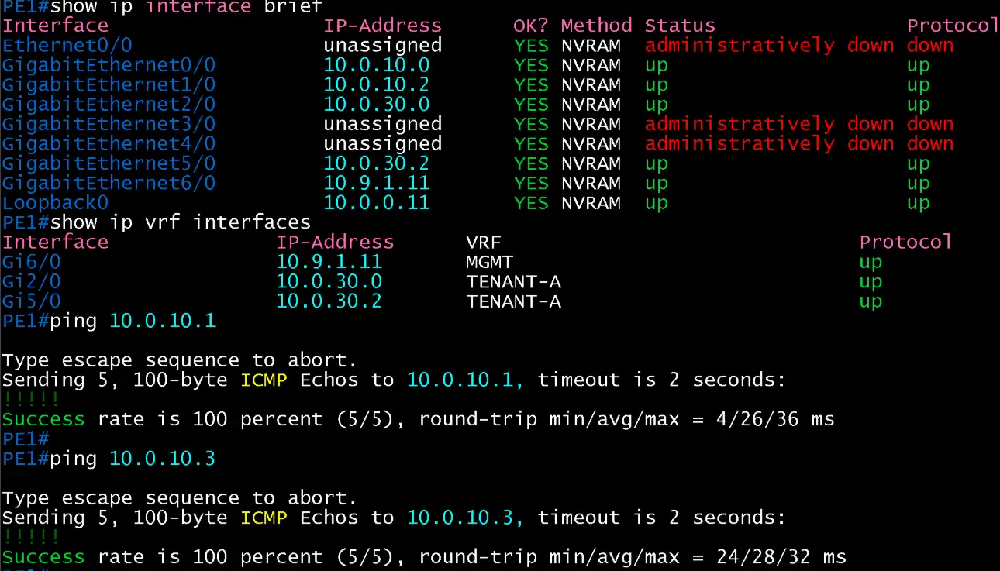

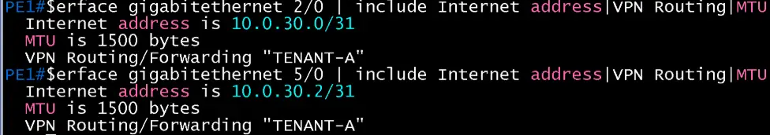

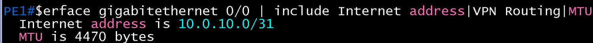

### PE2

- `show ip interface brief`: loopback0 10.0.0.12, Gi0/0 10.0.10.1(PE1), Gi1/0 10.0.10.4(PE3), Gi2/0 10.0.20.4(CX1), Gi3/0 10.0.20.6(CX2), 관리 Gi6/0 10.9.1.12가 up/up
- `show ip vrf interfaces`: Gi2/0, Gi3/0이 PARTNER, Gi6/0이 MGMT
- `ping 10.0.10.0`(PE1) 5/5(32/44/64ms), `ping 10.0.10.5`(PE3) 5/5(32/56/68ms)
- `show ip interface gigabitethernet 2/0`, `3/0`: 10.0.20.4/31, 10.0.20.6/31, MTU 1500, VRF PARTNER. 코어 링크 `Gi0/0`은 MTU 4470

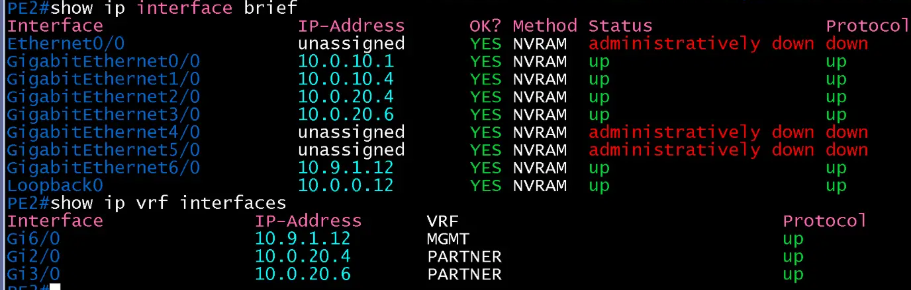

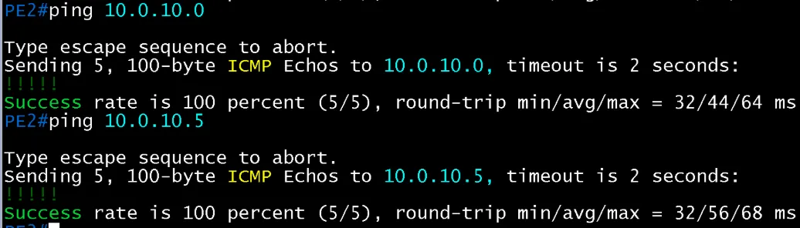

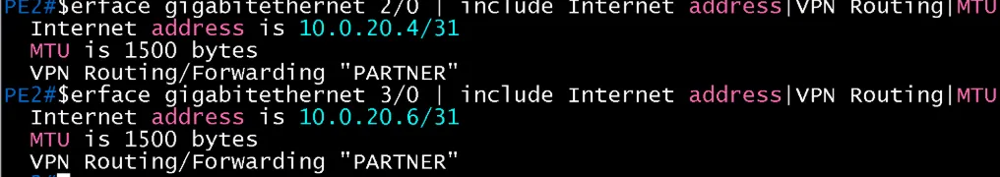

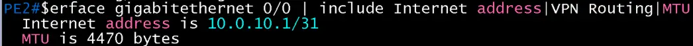

### PE3

- `show ip interface brief`: loopback0 10.0.0.13, Gi0/0 10.0.10.3(PE1), Gi1/0 10.0.10.5(PE2), Gi2/0 10.0.60.0(BGW1), Gi3/0 10.0.60.2(BGW2), 관리 Gi6/0 10.9.1.13이 up/up. 서브인터페이스 목록은 없음(PE3 재부팅 후 화면)
- `show ip vrf interfaces`: Gi2/0, Gi3/0이 BR1, Gi6/0이 MGMT
- PE3의 BGW 링크는 PE1(Hub), PE2(CX)와 같이 물리 포트에 주소와 VRF를 직접 줌. 처음에는 dot1q 100 서브인터페이스(`.100`)로 구성했으나 쓸 이유가 없어 2026-11-14에 물리 포트로 통일(BGW1·2 `Gi0/0`도 같음)
- 변경 뒤 확인(PE3 재부팅 후): PE3 BGP 이웃 PE1, PE2, BGW1(10.0.60.1), BGW2(10.0.60.3) Established(Up/Down 약 20초, 재부팅으로 세션이 새로 수립됨), BGW1·2의 PE3 이웃 Established, Host F -> Host A ping 4/4(TTL 57, 재부팅 전 화면)

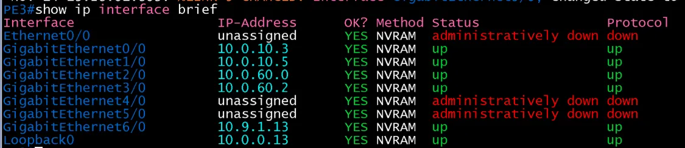

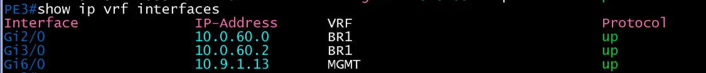

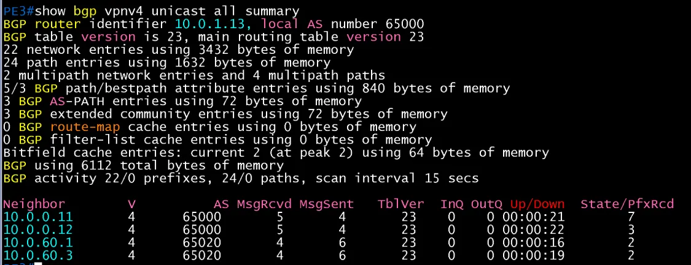

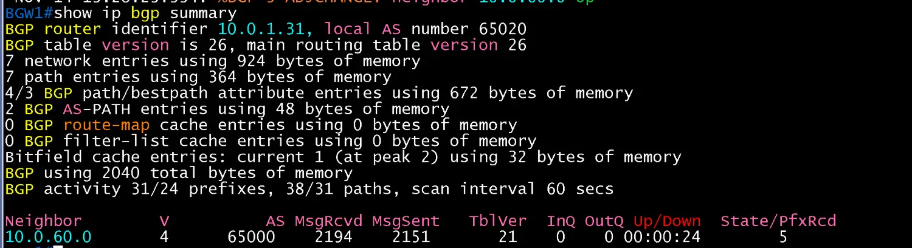

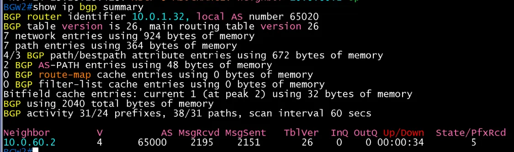

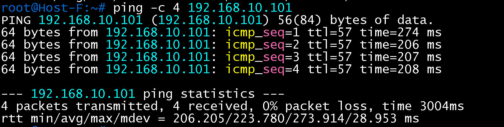


## 결과 기록

| 일시 | 장비 | 결과 (성공, 실패) | 비고 |
|---|---|---|---|
| 2026-10-22 | PE1 | 성공 | IP, VRF 소속, description 문서와 일치. ping은 아직 미실시 |
| 2026-10-22 | PE2 | 성공 | 상동 |
| 2026-10-22 | PE3 | 성공 | 상동 |
| 2026-11-14 | PE1~PE3 | 성공 | 최종 구성(VRF TENANT-A, PARTNER, BR1, MGMT)에서 IP, VRF 소속, PE 간 ping 5/5 재확인. 이전 구성 화면은 교체함 |
