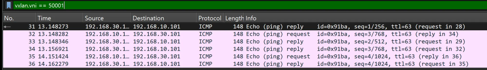
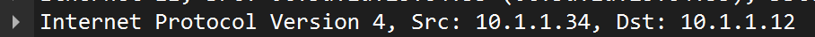
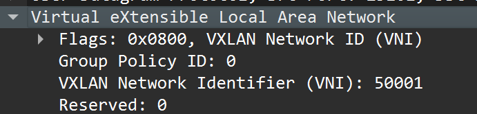
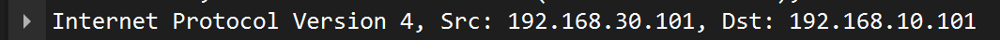

# EVPN-VXLAN 검증

> 이 문서의 화면과 값은 2026-11-14 타이머 변경 전 구성에서 측정한 기록(BGP keepalive 3 / hold 9 -> 현재 keepalive 30 / hold 90)임. 현재 타이머 기준 장애 시험 결과는 [장애 시험](09-failover.md) 참고

**선행 조건**: **모든 spine, leaf에서 `service routing protocols model multi-agent`를 설정하고 `write memory` 후 `reload`(재부팅)한 상태여야 함**(재부팅 전에는 `address-family evpn`이 거부됨). [MLAG 검증](02-mlag.md)이 끝나 있고, [leaf 샘플](../../samples/dc1/07-evpn-vxlan-leaf.md)과 [spine 샘플](../../samples/dc1/08-evpn-spine.md)이 적용되어 있어야 함

기준 문서: [05-evpn-vxlan.md](../../baseline/dc1/05-evpn-vxlan.md)

## 확인 항목

| 순서 | 장비 | 명령 | 기대 결과 | 안 될 때 확인 |
|---|---|---|---|---|
| 0 | 모든 leaf, spine | `show running-config \| include routing protocols` | `service routing protocols model multi-agent`가 보임(**reload 후**) | 없으면 설정, `write memory`, `reload` |
| 1 | leaf1~leaf4 | `show bgp evpn summary` | spine1, spine2 두 세션이 **Established** | OSPF 도달성, update-source loopback0, AS 번호(65100), send-community extended, spine의 route-reflector-client |
| 1-1 | leaf1 | `show bgp neighbors 10.1.0.1` | **keepalive 3초, hold 9초**가 협상됨 (양쪽 `timers 3 9`) | 이웃 peer group의 `timers 3 9`, 양쪽 값 |
| 1-2 | spine1 | `show bgp evpn summary` | leaf 4대(10.1.0.11 ~ 10.1.0.14)가 **Established**이고 leaf끼리는 이웃으로 보이지 않음 | cluster-id, route-reflector-client |
| 1-3 | leaf1 | `show bgp neighbors 10.1.0.1` | `remote router ID`가 **10.1.2.1**(spine1의 BGP router-id). OSPF router-id(`show ip ospf neighbor`의 10.1.0.1)와 **다른 값** | 장비의 `router-id`(BGP)가 OSPF와 다른지, 10.1.2.x |
| 2 | leaf1~leaf4 | `show interfaces vxlan1` | **up/up**, `Source interface is Loopback1 and is active`(leaf1·2 10.1.1.12, leaf3·4 10.1.1.34), `UDP port 4789`, VLAN-VNI 매핑, `MLAG Shared Router MAC`이 MLAG 쌍끼리 같음 (**BGP 전에도 확인 가능**) | vxlan source-interface, `vxlan vlan ... vni`, `vxlan virtual-router encapsulation mac-address mlag-system-id`, MLAG system-id |
| 3 | leaf1 | `show vxlan vtep` | 원격 VTEP **10.1.1.34**(leaf3, leaf4 공유)가 보임 | Loopback1 광고, vxlan source-interface |
| 4 | leaf1, leaf3 | `show vxlan vni` | leaf1은 VNI **10010**(VLAN 10)과 **50001**(L3VNI, 동적 VLAN 4093, VRF TENANT-A), leaf3·4는 10010, 10020, 50001 | vxlan vlan ... vni, VRF 설정 |
| 5 | leaf1 | `show bgp evpn route-type mac-ip` | Host A, B, C의 MAC/IP 경로 | 호스트 ARP(ping으로 학습 유도) |
| 7 | Host A | `ping -c 3 192.168.30.101` | Host C 응답 (**다른 VLAN, L3VNI**) | VRF TENANT-A, L3VNI 50001, SVI |
| 8 | leaf1 | `show ip route vrf TENANT-A` | 192.168.30.0/24가 VXLAN 경유로 보임 | redistribute connected, RT import/export |
| 9 | leaf3 | `show bgp evpn route-type mac-ip` | leaf1이 광고한 경로에 **ORIGINATOR_ID**(leaf1 BGP router-id 10.1.2.11)와 **CLUSTER_LIST**(10.1.0.100)가 보임 (spine이 reflect) | RR 설정, cluster-id |
| 10 | spine1 | `show ip access-lists MGMT-ACL` | 규칙 40, 50(BGP)의 카운터가 올라감 | 관리 ACL이 BGP를 허용하는지 |

## 장애 시험

| 동작 | 기대 결과 |
|---|---|
| spine1 정지 | EVPN 세션이 spine2 하나로 유지되고 ping은 계속 됨 |
| leaf3 정지 | Host C는 leaf4와 같은 쌍이므로 계속 통신 |

- VNI 매핑(leaf1 `show interfaces vxlan1`, leaf3 `show vxlan vni`)과 MAC/IP 경로 증빙은 최종 구성 화면이 [VLAN·MSTP 검증](07-vlan-mstp.md)에 있음

## 증빙 (iBGP RR, EVPN 세션과 VTEP, 2026-10-22)

spine1·2를 Route Reflector로, leaf1~4를 client로 설정한 뒤의 화면

### 1. EVPN 세션 Established (항목 1, 1-2)

| 장비 | 화면 | 볼 곳 |
|---|---|---|
| spine1 |  | `Router identifier 10.1.2.1`, AS 65100, leaf 4대(10.1.0.11 ~ 10.1.0.14)가 모두 **Estab** |
| spine2 |  | `Router identifier 10.1.2.2`, leaf 4대가 모두 **Estab** |
| leaf1 |  | `Router identifier 10.1.2.11`, spine1(10.1.0.1), spine2(10.1.0.2)가 **Estab**, PfxRcd 10 |
| leaf2 |  | `Router identifier 10.1.2.12`, spine 2대 Estab, PfxRcd 10 |
| leaf3 |  | `Router identifier 10.1.2.13`, spine 2대 Estab, PfxRcd 8 |
| leaf4 |  | `Router identifier 10.1.2.14`, spine 2대 Estab, PfxRcd 8 |

- **BGP router-id**(`Router identifier`)가 모든 장비에서 `10.1.2.x`이고, 이웃 주소(`Neighbor`)는 `loopback0`(10.1.0.x). OSPF router-id(10.1.0.x)와 BGP router-id가 다름
- 세션은 총 8개(leaf 4대 x spine 2대)이고 모두 AS 65100(iBGP). leaf끼리는 이웃을 맺지 않음
- spine이 leaf에서 받은 경로(PfxRcd)는 leaf1·2가 각 2개, leaf3·4가 각 4개이고, leaf는 spine에서 8 ~ 10개를 받음. spine이 RR로 다른 leaf의 경로를 reflect해서 준 것
- 이 화면은 `service routing protocols model multi-agent`를 적용(`write memory`, `reload`)한 뒤 `address-family evpn`이 받아들여진 상태. 적용 전에는 `% Routing protocols model multi-agent must be configured for EVPN address-family`가 나옴

### 2. 원격 VTEP (항목 3)

| 장비 | 화면 | 볼 곳 |
|---|---|---|
| leaf1 |  | 원격 VTEP **10.1.1.34**(leaf3·4가 공유하는 VTEP), `unicast, flood`, Total 1 |
| leaf2 |  | 같음 (10.1.1.34) |
| leaf3 |  | 원격 VTEP **10.1.1.12**(leaf1·2가 공유), Total 1 |
| leaf4 |  | 같음 (10.1.1.12) |

- MLAG 쌍이 VTEP 주소를 공유하므로 각 leaf는 원격 VTEP을 **한 개**로 봄(상대 쌍의 공유 주소). 터널 종류 `unicast, flood`는 EVPN으로 알게 된 VTEP에 flood 목록을 만들었다는 뜻
- `show bgp evpn route-type mac-ip`는 호스트 MAC이 학습되기 전에는 비어 있음(호스트가 트래픽을 보내지 않으면 MAC이 만료됨). 호스트에서 ping을 보낸 뒤 재확인 필요

### 3. BGP 이웃 상세: 타이머와 router-id (항목 1-1, 1-3)

`show bgp neighbors 10.1.0.1`(leaf에서 spine1) 화면의 윗부분

| 장비 | 화면 |
|---|---|
| leaf1 |  |
| leaf2 |  |
| leaf3 |  |
| leaf4 |  |

- **`remote router ID 10.1.2.1`**: spine1의 BGP router-id. 이웃 주소(10.1.0.1, spine1의 loopback0)와 OSPF router-id(10.1.0.1)와 다른 값. 각 leaf의 `local router ID`는 `10.1.2.11 ~ 10.1.2.14`
- **`Hold time is 9, keepalive interval is 3 seconds`**, `Configured hold time is 9, keepalive interval is 3 seconds`: `timers 3 9`가 적용되어 협상되었음
- `Inherits configuration from and member of peer-group SPINES`: peer group 설정을 상속. `internal link`, remote AS 65100(iBGP)
- `Multiprotocol L2VPN EVPN: advertised and received and negotiated`가 같은 출력의 아랫부분에 있고, `Extended` 커뮤니티를 보냄(`send-community extended`).
- `Last sent socket-error:Connect (Network is unreachable)`가 5회 보이는 것은 reload 직후 OSPF가 loopback 경로를 만들기 전에 시도한 연결이 실패한 흔적. 현재 `Established`이고 `Number of transitions to established: 1`이라 이후 끊김이 없음

### 6. 다른 VLAN 통신: Host A -> Host C (L3VNI) (항목 7, 2026-11-14)

- `ping -c 4 192.168.30.101`(Host C, VLAN 30)이 4개 중 4개 응답, 손실 0%, TTL 62. Host A는 leaf1(VLAN 10)에 있어서 VRF `TENANT-A`로 라우팅한 뒤 **L3VNI(VNI 50001)** 로 leaf3·4 VTEP에 전달됨
- 같은 VLAN 안의 두 호스트는 최종 구성에 없어(VLAN 10에는 Host A만 있음) L2VNI 통신 시험은 하지 않음. MAC/IP 경로 증빙은 [VLAN·MSTP 검증](07-vlan-mstp.md)

### 8. 관리 ACL이 BGP, OSPF를 통과시킴 (항목 10)

- 규칙 30(OSPF) 6949, 규칙 40·50(BGP, `10.1.0.0/24`끼리) 2708과 2727, 규칙 60(MLAG) 7839 packets가 쌓였음. 관리 ACL이 BGP와 OSPF 통신을 막지 않고 통과시킴.
- 규칙 80(deny)은 65이고, 설정이 없는 장비의 DHCP 요청 같은 쓰지 않는 트래픽

## 패킷 캡처 (Wireshark, 2026-11-14)

캡처 링크는 spine1 - leaf3 구간, 표시 필터 `vxlan.vni == 50001`. Host A에서 `ping -c 4 192.168.30.101`을 실행

### VXLAN 캡슐화 (L3VNI 50001)

| 계층 | 값 | 뜻 |
|---|---|---|
| 바깥 IP | `10.1.1.34` -> `10.1.1.12` | leaf3·4 공유 VTEP에서 leaf1·2 공유 VTEP으로(Host C -> Host A 응답 방향) |
| UDP | 목적지 포트 **4789**, 출발 포트 25101 | VXLAN 표준 포트. 출발 포트는 안쪽 흐름의 해시값 |
| VXLAN | **VNI 50001**, Flags 0x0800 | VRF TENANT-A의 L3VNI |
| 안쪽 IP, ICMP | `192.168.30.101` -> `192.168.10.101` (TTL 63) | Host C가 Host A로 보낸 echo 응답이 캡슐화됨. 요청은 `192.168.10.101` -> `192.168.30.101` |

### BGP OPEN (Frame 462, 표시 필터 `bgp`)

| 필드 | 값 | 뜻 |
|---|---|---|
| IP | `10.1.0.1` -> `10.1.0.11` | spine1 loopback0 -> leaf1 loopback0 (`update-source loopback0`) |
| TCP | 목적지 포트 **179** | BGP |
| My AS | **65100** | DC1 iBGP AS |
| Hold Time | **9** | `timers 3 9` (keepalive는 hold의 1/3인 3초) |
| BGP Identifier | **10.1.2.1** | spine1의 BGP router-id. 출발 주소(10.1.0.1)와 OSPF router-id(10.1.0.1)와 **다른 값** |

- 출발 IP(loopback0, 10.1.0.1)와 BGP Identifier(10.1.2.1)가 다른 것이 router-id를 분리한 증거
## 결과 기록

| 일시 | 결과 (성공, 실패) | 비고 |
|---|---|---|
| 2026-10-22 | 성공 (장애 시험 제외) | 항목 0~10 모두 확인: 세션 Established, 타이머 3/9, remote router ID 10.1.2.1, 원격 VTEP, VNI 매핑(10010, 50001), MAC/IP·IMET 경로와 RR 속성, Host A -> Host B(L2VNI), Host A -> Host C(L3VNI), VRF 경로, ACL BGP 카운터. Wireshark VXLAN(VNI 10010), BGP OPEN 확인. 장애 시험(spine1 정지, leaf3 정지)은 구축 후 |
