# MTU 검증 (2026-11-14)

**선행 조건**: [MTU와 TCP MSS 설계](../../00-overview/03-protocol-matrix.md)대로 PE, Spine, Leaf, Border Leaf, DSW, CX에 MTU를 적용한 뒤

기준 값: 코어 PE 간 링크 4470, DC1 패브릭 9214, SVI(DC1 leaf, DSW, CX) 1400. Hub, BGW, PE-CE 링크는 변경하지 않음

## 확인 항목

| 순서 | 구간 | 명령 | 기대 결과 |
|---|---|---|---|
| 1 | PE1~PE3 | `show running-config interface gigabitethernet 0/0 \| include mtu`, `gigabitethernet 1/0` | `mtu 4470` |
| 2 | PE1~PE3 | `show mpls interfaces detail` | 두 코어 인터페이스의 `MTU = 4470` (`mpls mtu`를 따로 입력하지 않아도 인터페이스 MTU를 따름) |
| 3 | PE1~PE3 | `ping <상대 PE loopback> size 4000 df-bit` | 5/5 응답 (4000바이트 패킷이 조각화 없이 통과) |
| 4 | PE1~PE3 | `show ip ospf neighbor`, `show mpls ldp neighbor`, `show bgp vpnv4 unicast all summary` | OSPF FULL, LDP Oper, BGP Established 유지 |
| 5 | Spine1·2 | `show interfaces ethernet1 \| include MTU`, `show ip ospf neighbor`, `show bgp evpn summary` | IP MTU 9214, 이웃 6개 FULL, EVPN 6개 Established |
| 6 | Leaf1~4 | `show interfaces vlan10 \| include MTU` (vlan 20, 30, 99), `show ip ospf neighbor`, `show bgp evpn summary`, `show mlag` | IP MTU 1400, OSPF 이웃 2개 FULL, EVPN 2개 Established, MLAG Active |
| 7 | Border Leaf1·2 | `show ip ospf neighbor`, `show ip bgp summary vrf TENANT-A` | OSPF 이웃 2개 FULL, Hub eBGP Established |
| 8 | DSW1·2, CX1·2 | `show ip interface vlan 50 \| include MTU` (vlan 60), CX는 `show ip interface vlan110` | MTU 1400 |
| 9 | 경로 MTU | `ping -M do -c 3 -s 1372 <대상>`, `-s 1373` | 1372(패킷 1400바이트)는 응답, 1373(1401바이트)은 `Frag needed and DF set (mtu = 1400)` |
| 10 | TCP | `iperf3 -c <대상> -t 10 -b 5M` | 데이터 전달 여부 확인 |

## 증빙

### 코어 PE (항목 1 ~ 4)

PE마다 `mtu 4470`이 두 코어 인터페이스(`Gi0/0`, `Gi1/0`)에 들어가 있고, 변경 뒤에도 OSPF 이웃 2개가 FULL, LDP 이웃 2개가 Oper, BGP 이웃이 Established로 유지됨. `show mpls interfaces detail`에서 `MPLS MTU = 4470`으로 `mpls mtu`를 따로 입력하지 않아도 인터페이스 MTU를 따름. 4000바이트 df-bit ping이 PE끼리 5/5 응답

#### PE1

- `show interfaces gigabitethernet 0/0`, `1/0 | include MTU`, `show mpls interfaces detail`, `show ip ospf neighbor`(10.0.0.13, 10.0.0.12 FULL), `show mpls ldp neighbor`(두 이웃 Oper, Up 02:12시간대)
- `ping 10.0.0.12 size 4000 df-bit`: 5/5, 64/77/96ms

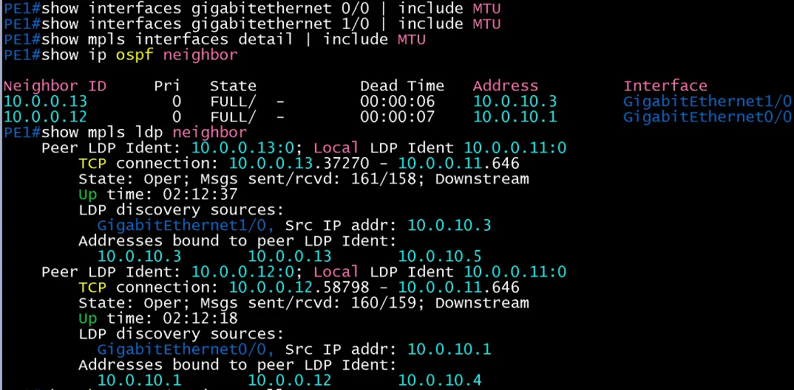
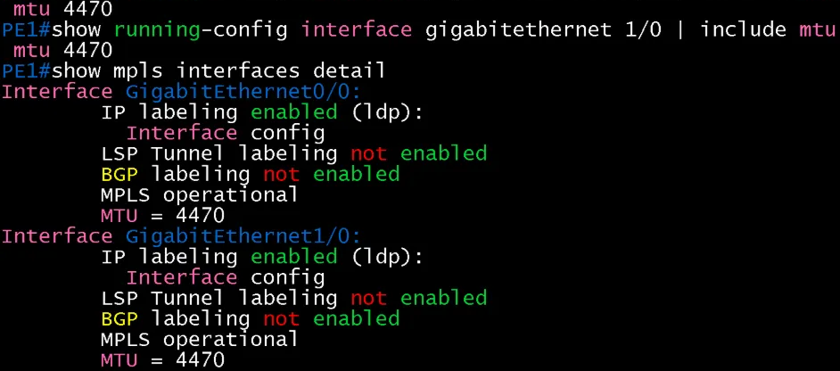
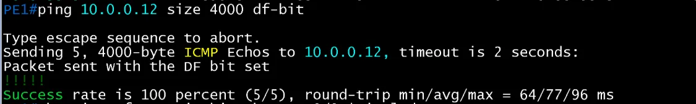
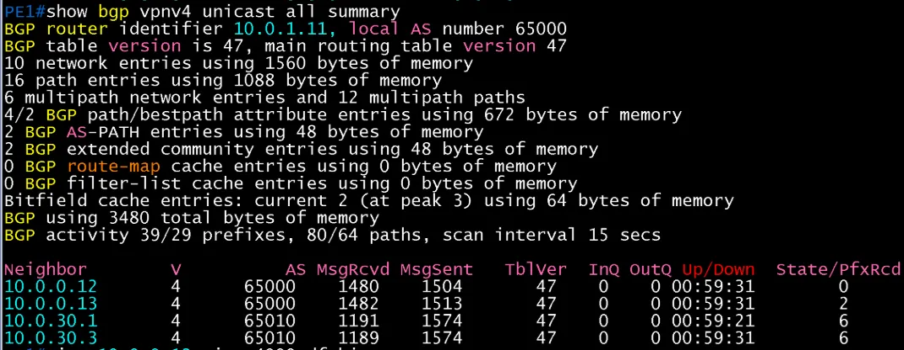

#### PE2

- `mtu 4470`이 `Gi0/0`, `Gi1/0`에 들어가 있고 OSPF 이웃 PE3(10.0.0.13), PE1(10.0.0.11)이 FULL
- `ping 10.0.0.13 size 4000 df-bit` 5/5(32/44/60ms), `ping 10.0.0.11 size 4000 df-bit` 5/5(40/68/92ms)

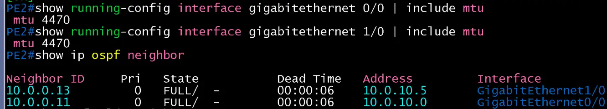
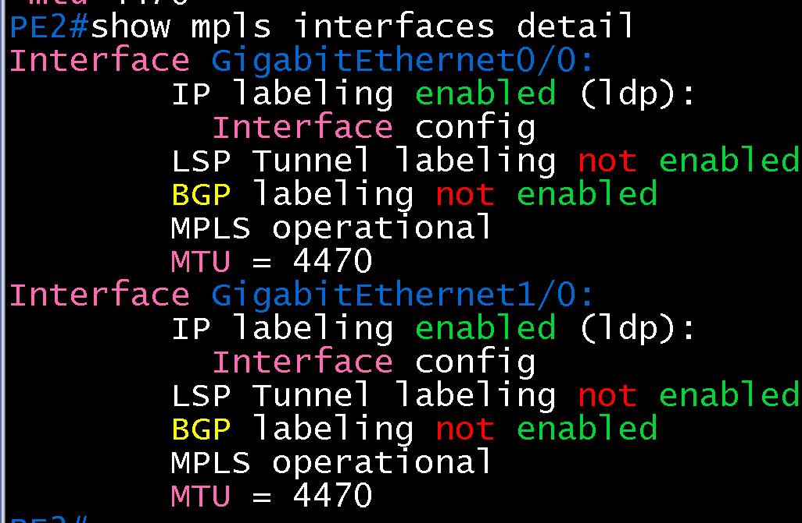
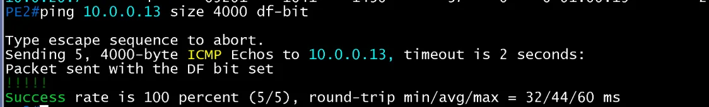
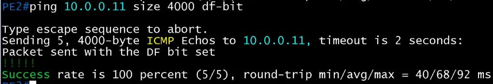

#### PE3

- `mtu 4470`이 `Gi0/0`, `Gi1/0`에 들어가 있고 OSPF 이웃 PE2(10.0.0.12), PE1(10.0.0.11)이 FULL
- `ping 10.0.0.11 size 4000 df-bit` 5/5(16/33/44ms), `ping 10.0.0.12 size 4000 df-bit` 5/5(4/26/32ms)
- `show bgp vpnv4 unicast all summary`: PE1, PE2, BGW1, BGW2 이웃이 Established

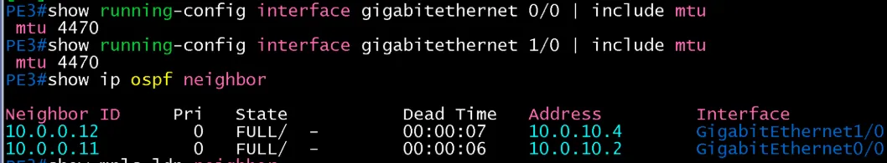
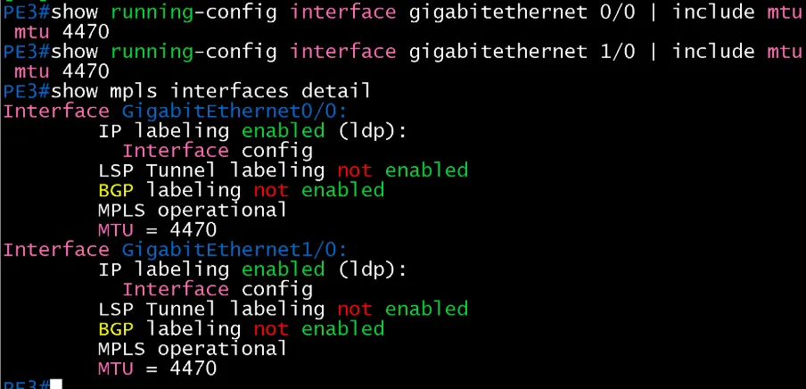
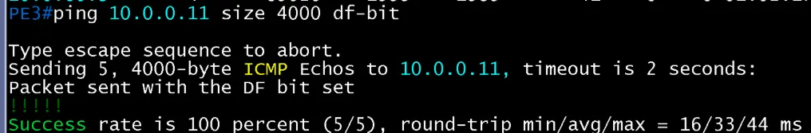
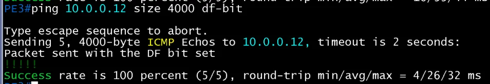
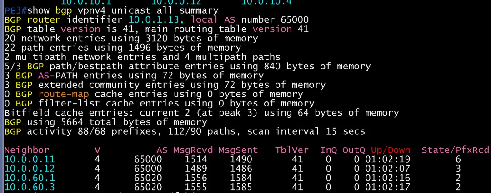

### DC1 패브릭 (항목 5 ~ 7)

- Spine1·2: `show interfaces ethernet1 | include MTU`에서 `IP MTU 9214 bytes`. OSPF 이웃 leaf 4대와 border leaf 2대 총 6개가 FULL, EVPN 이웃 6개가 Established
- Leaf1: vlan 10·20·30·99 모두 `IP MTU 1400 bytes`, OSPF 이웃 Spine1·Spine2 FULL, EVPN 이웃 2개 Established(경로 30), MLAG Active·Connected, peer-link와 local-interface Up
- Leaf2·3·4: vlan 10·20·30·99 모두 `IP MTU 1400 bytes`
- Border Leaf1·2: OSPF 이웃 Spine1·Spine2 FULL, VRF TENANT-A에서 Hub eBGP Established(경로 2)

#### Spine

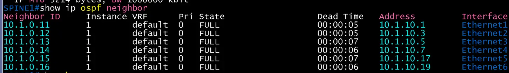
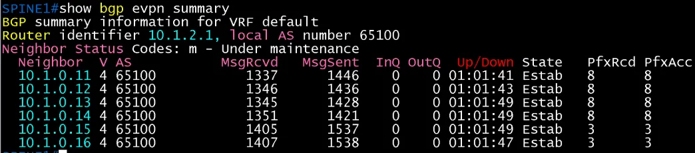

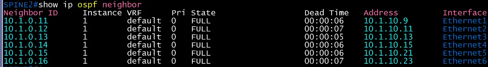
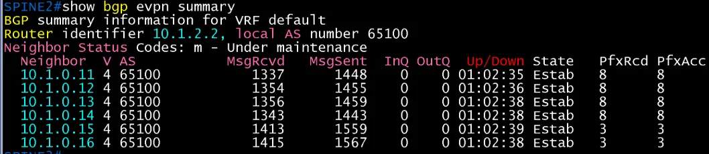

#### Leaf

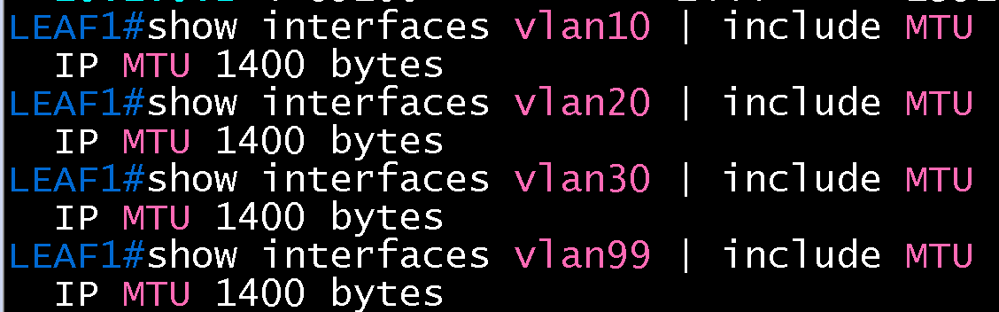
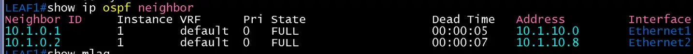
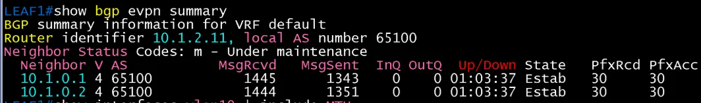
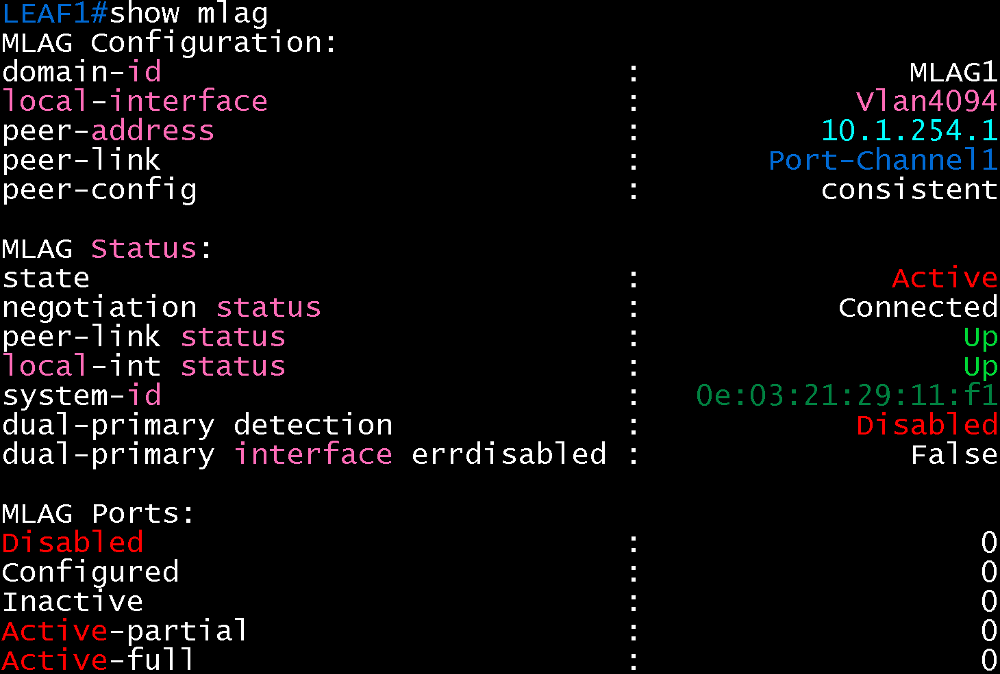
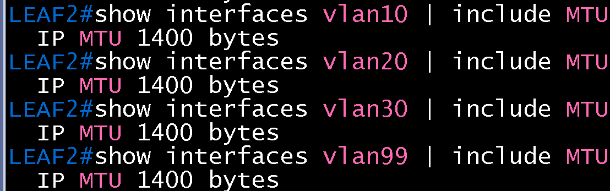
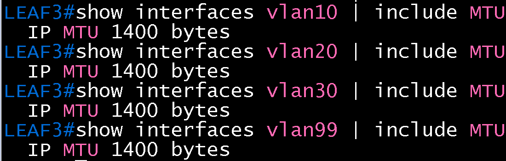
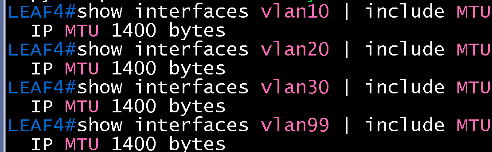

#### Border Leaf

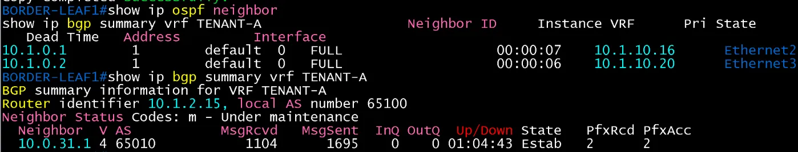
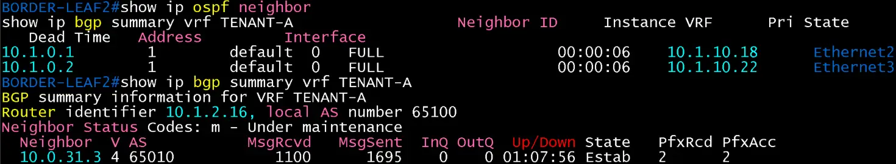

### 개발지사 DSW와 DC2 CX (항목 8)

- DSW1·DSW2: vlan 50, vlan 60 모두 `MTU is 1400 bytes`
- `show run | include adjust-mss`를 DSW1·DSW2에서 실행했지만 **출력이 없음**. `ip tcp adjust-mss 1360`이 running-config에 보이지 않아 MSS 클램핑은 적용을 확인하지 못함
- CX1·CX2: `show ip interface vlan110`에서 `IP MTU 1400`(active-gateway 192.168.110.1, 장비 주소 .2, .3)

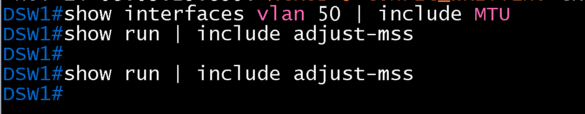
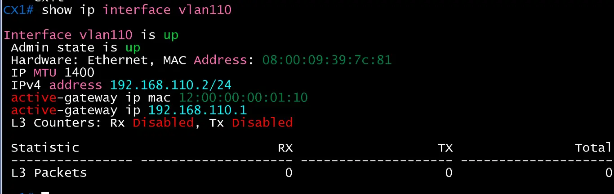
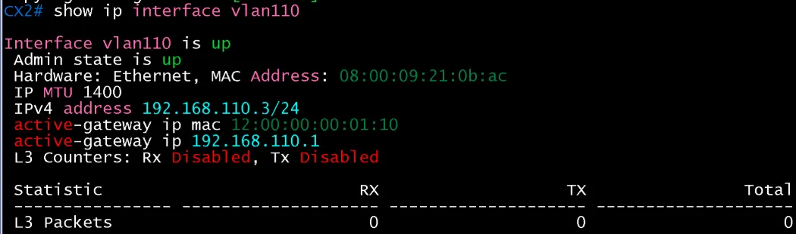

### 경로 MTU (항목 9)

- Host F -> Host C(`192.168.30.101`): `-s 1372`(패킷 1400바이트) 3/3 응답, `-s 1373`(1401바이트)은 `From 192.168.30.1 Frag needed and DF set (mtu = 1400)`으로 100% 손실
- Host E -> Host F(`192.168.50.101`): `-s 1372` 3/3 응답, `-s 1373`은 `From 10.50.0.3 Frag needed and DF set (mtu = 1400)`
- 두 방향 모두 SVI MTU 1400이 경로 MTU로 보임

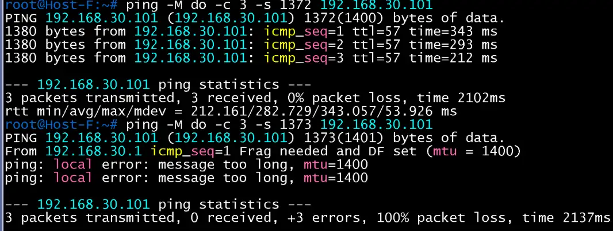
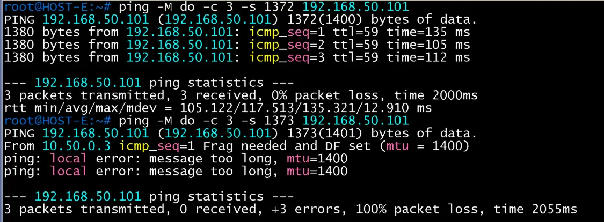

### TCP (항목 10)

- Host F -> Host C `iperf3 -c 192.168.30.101 -t 10 -b 5M`: 연결은 성립하지만 대부분 구간이 `0.00 Bytes`이고 재전송(Retr)이 계속 나옴. 합계는 sender 128KBytes(105Kbits/sec, Retr 44), receiver 85.6KBytes(68.6Kbits/sec)
- 같은 증상이 MTU 변경 전에도 있었고(경로 MTU와 무관하게 TCP 데이터가 전달되지 않음) 원인은 확인하지 못함. MSS 클램핑 효과도 이 환경에서는 확인하지 못함

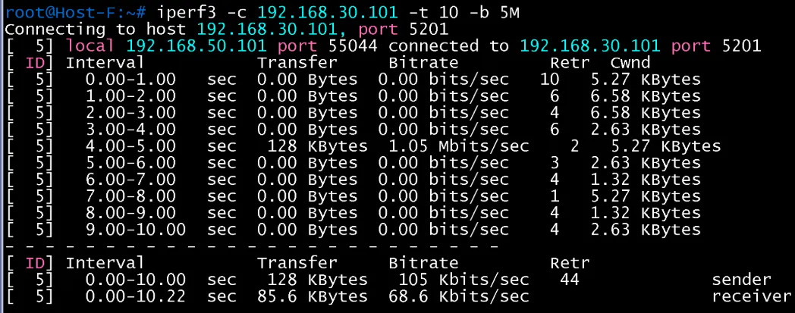
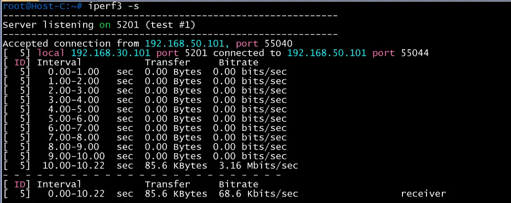

## 결과 기록

| 일시 | 구간 | 결과 | 비고 |
|---|---|---|---|
| 2026-11-14 | 코어 PE, DC1 패브릭, DSW·CX SVI | 성공 | MTU 값 적용과 OSPF·LDP·BGP·EVPN·MLAG 유지 확인, 4000바이트 df-bit ping 5/5, 경로 MTU 1400 확인 |
| 2026-11-14 | DSW MSS 클램핑(`adjust-mss 1360`) | 미확인 | `show run | include adjust-mss` 출력 없음 |
| 2026-11-14 | TCP(iperf3) | 실패(원인 미확인) | MTU와 무관하게 데이터가 전달되지 않음 |
